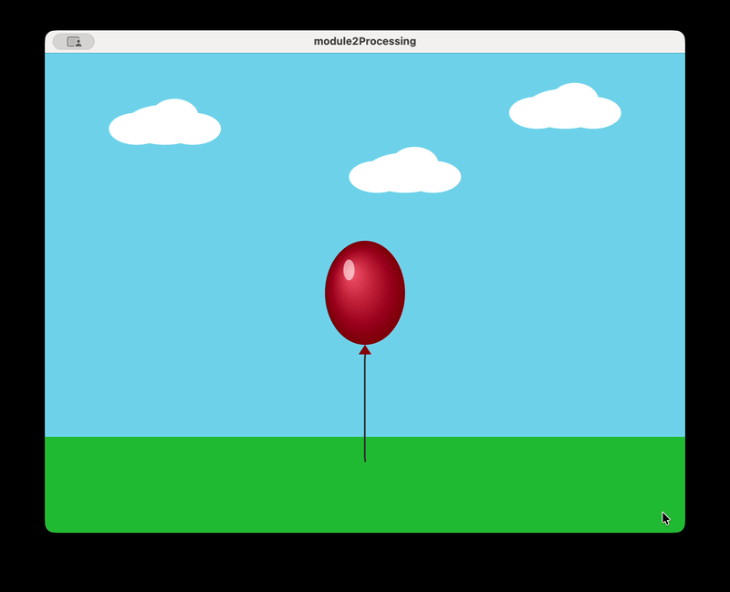
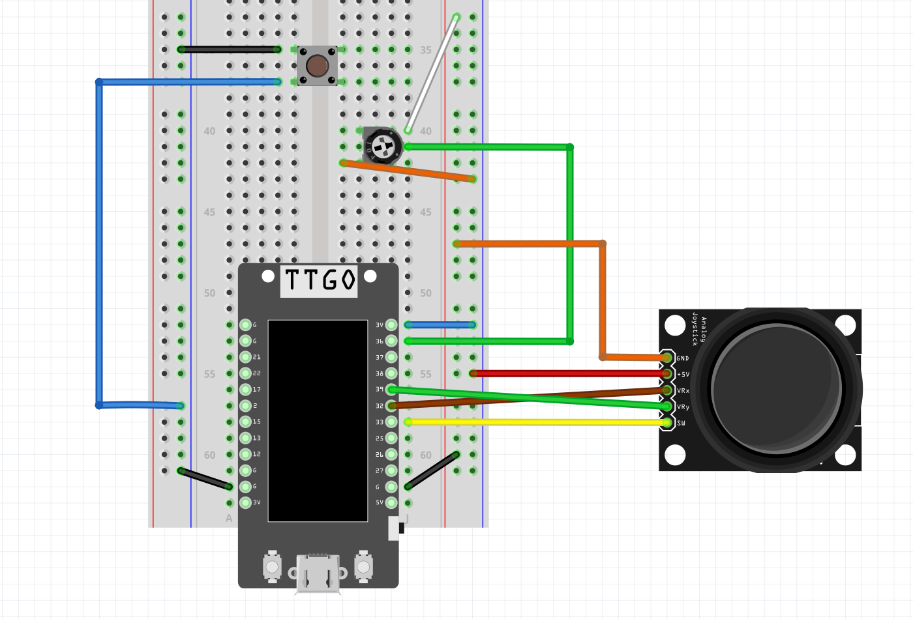
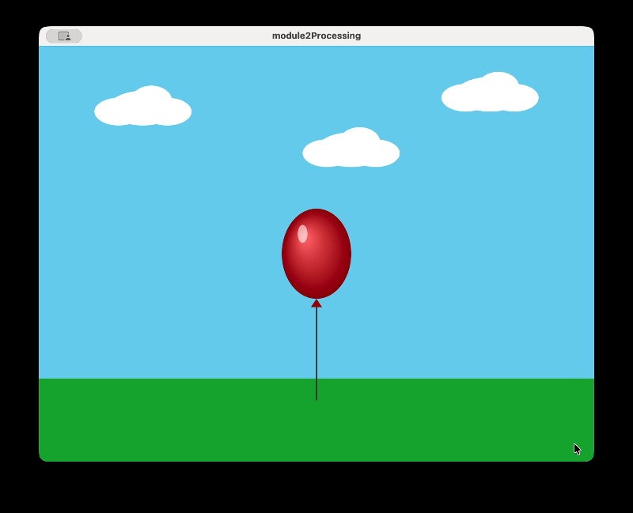

# Interactive Balloon Game 

This is an interactive balloon game controlled by a user's physical inputs. An ESP32 reads a joystick, potentiometer, and 2 buttons (one on the joystick, another standalone), and a Processing sketch turns those inputs into a balloon you can steer, inflate, pop, and change its colors. 

## Hardware

- ESP32 LILYGO T-Display board
- USB-C cable
- Breadboard and jumper wires
- Joystick
- Potentiometer
- Push button

### Wiring 

| Part | Connection |
|---|---|
| Joystick VRx | GPIO 32 |
| Joystick VRy | GPIO 39 |
| Joystick SW (button) | GPIO 33 |
| Joystick VCC / GND | 3V3 / GND |
| Potentiometer wiper (middle pin) | GPIO 36 |
| Potentiometer outer pins | 3V3 and GND |
| Pop button | GPIO 2 and GND |

Notes on the wiring: 
- The potentiometer is wired so that the reading is 4095 at the start and falls toward 0 as it gets turned. For recreation, if yours reads the other way, swap the two outer pins, or change the `map()` call in `updateInflation()`.

## How it Works

A red balloon with a string starts in the middle of a sky and grass scene. 
The joystick moves the balloon around the screen, but it stays fully inside the window with the string swinging along. 
The joystick button cycles the balloon color (red, blue, yellow, green, purple, orange, pink, back to red,...).
The potentiometer inflates and deflates the balloon. The starting size is the minimum. If the potentiometer is turned up to the maximum it stops inflating and starts to shake. If the user keeps it there for 2.5 seconds, it pops. If they dial it back in time, it stops shaking and won't pop.
The standalone button pops the balloon immediately.

When the balloon pops, a burst of particles in the balloon's current color flies outward in the balloon's shape and the string falls to the ground. A new balloon at the original minimum size appears in the center about a second later. 

Notes:
- The joystick sets the balloon's speed, not its position, so letting go leaves the balloon where it is. I set a deadzone around the joystick's resting x and y values to stop that small range of noise from letting the balloon drift while or after you move it.

## Adjustments for running it 

1. Calibrating the joystick

Every joystick rests at a slightly different value. In the Processing sketch, `centerX` and `centerY` are set to the resting values of the joystick used here. To find yours, print `joyX` and `joyY` with your hands off the stick and update those two numbers. If the balloon drifts when the joystick is released, raise `deadzone` to account for a larger range of potential values.

2. Constants at the top of the sketch can also be adjusted:

`maxSpeed`: top speed of the balloon at full joystick push, in pixels per frame
`deadzone`: how far the joystick must move from rest before the balloon responds
`maxScale`: fully inflated size, as a multiple of normal (as in, 2.0 = double)
`safeLimit`: fraction of the potentiometer's travel where the balloon reaches maximum size (0.8 = 80%)
`popTime`: seconds in the danger zone before the balloon pops
`respawnDelay`: seconds between a pop and the new balloon
`numPoints`, `segLen`: number of string points and the distance between them

3. Known issues
   
- The balloon's "normal" size is tied to the potentiometer's raw value, not to where it sits when the program starts. If the potentiometer is turned up when the sketch begins (or when a new balloon appears after an over-inflation pop), the balloon starts inflated or immediately begins to shake. The potentiometer needs to be turned back to avoid this.
- The serial port number in the Processing sketch is hard-coded and has to be updated by hand.

## Credits 

The balloon's shading is adapted from the Radial Gradient example that comes with Processing (Examples > Basics > Color). I kept its approach of drawing concentric ellipses from the largest to the smallest while updating a running color, but changed the color to step brightness and saturation from the balloon's own color, shifted the rings toward a light source, and scaled them to the balloon's size.
 
Wiring diagram made in [Fritzing].

